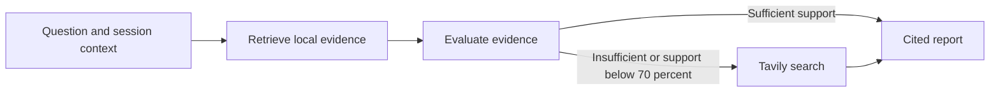

# UdaPlay Research Agent

UdaPlay answers video-game questions using a persistent ChromaDB collection of fifteen supplied games. It retrieves local evidence, evaluates whether that evidence answers the question, searches Tavily when needed, and returns a structured answer with confidence and source citations. The supplied state-machine library executes the workflow. Conversation history resolves follow-up questions within each session.

**Submission status:** Part 1 has been executed with real OpenAI embeddings and saved outputs, including all 15 records, collection persistence and semantic search. Part 2's live agent demonstration is pending a Tavily credential. This repository is not yet a rubric-complete submission; `scripts/verify_submission.py` intentionally fails until both executed notebooks are saved.

## Contents

```text
project/starter/
  Udaplay_01_starter_project.ipynb   # Dataset ingestion, persistence and semantic search
  Udaplay_02_starter_project.ipynb   # Research workflow and required demonstrations
  games/                           # Original fifteen game records
  lib/udaplay.py                    # Research tools, reports, vector store and agent
  lib/                             # Supplied course library
tests/                             # Offline tests and real Chroma/kernel integration tests
scripts/execute_notebooks.py        # Execute both notebooks in clean kernels and save outputs
scripts/verify_submission.py        # Source checks and saved-execution gate
PROJECT_REQUIREMENTS.md             # Source register and rubric matrix
VALIDATION.md                       # Actual results and remaining blockers
```

## Setup

Use Python 3.13. The assignment supports Python 3.11 or newer; this implementation was tested with 3.13.

```bash
python3.13 -m venv .venv
source .venv/bin/activate
python -m pip install -r requirements-lock.txt
cp .env.example .env
```

Fill in `.env` locally. For the Udacity workspace, use its `voc-` OpenAI key and `https://openai.vocareum.com/v1` endpoint. For a personal OpenAI account, use its key and set `OPENAI_BASE_URL=https://api.openai.com/v1`. Provide a Tavily key in `TAVILY_API_KEY`. Keep `.env` out of Git. Part 1 checks only the OpenAI key and endpoint; Part 2 checks all three values without printing credentials.

The defaults are `gpt-4o-mini` and `text-embedding-3-small`; `OPENAI_MODEL` and `OPENAI_EMBEDDING_MODEL` can override them if supported by the configured provider. Both notebooks use `OPENAI_API_KEY` for embeddings, rather than requiring a second Chroma key. Configuration can be placed in `project/starter/.env`, `project/.env`, the repository root `.env`, or its parent `Research Agent/.env`; the nearest file takes precedence over exported environment values.

## Validate and run

Run these commands from the repository root:

```bash
python -m pytest tests -q
python scripts/verify_submission.py --source-only
python scripts/execute_notebooks.py
python scripts/verify_submission.py
```

To execute just Part 1 with OpenAI configured, use `python scripts/execute_notebooks.py --part 1`. After configuring Tavily, use `--part 2` to run the agent against the existing local database. Omit `--part` to execute both notebooks in order.

The test suite uses deterministic provider substitutes and a temporary real Chroma database; it makes no paid calls. The notebook execution command uses real OpenAI and Tavily requests and may incur provider charges. It runs Part 1 before Part 2 with the correct working directory, saves successful notebook executions in place, and enforces the evidence gate. Keep the generated `project/starter/chromadb/` locally between interactive runs; it is excluded from Git and can be rebuilt from the supplied records.

For interactive execution, use the environment's Jupyter tooling and open the notebooks from `project/starter`. Run all cells in Part 1, save it, then run all cells in Part 2 and save it. Publish those executed notebook files after reviewing their outputs and confirming no secrets appear.

## Workflow and evidence



Part 2 demonstrates the three supplied questions: Pokémon Gold and Silver's release, the first 3D Mario platformer, and Mortal Kombat X on PlayStation 5. It asserts that at least one answer uses local evidence, that Mortal Kombat X triggers web fallback, and that sources and stage traces are present. A fourth follow-up demonstrates session context. Results are printed as readable answers and structured JSON.

Similarity is not treated as proof of correctness. A structured evaluator checks whether the retrieved records actually answer the question. Low-support results trigger search. Final citation IDs must reference supplied evidence; web URLs are retained from Tavily rather than invented by the model. If no evidence is available, the agent reports an unanswered result with zero confidence. Provider failures propagate and are not stored as successful answers.

## Limits and attribution

Confidence is model-assessed support, not a calibrated accuracy score. The local data is small and static; web snippets can be incomplete or change. Session memory is held in the current Python process, and cross-session long-term memory is an optional extension not implemented here.

The `games/` records and the existing `lib/` modules originate from Udacity's supplied starter archive. `lib/udaplay.py`, tests and execution/validation helpers implement this project's requirements. See `LICENSE.md` for the supplied license. Comparable repositories and official documentation are recorded in `PROJECT_REQUIREMENTS.md`; their implementation code was not copied. AI assistance was used in development; review the implementation and follow your course's disclosure requirements.
