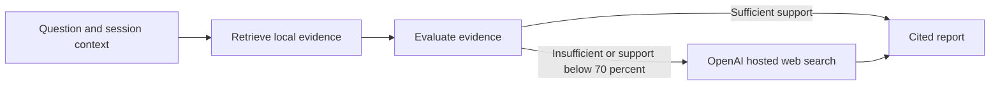

# UdaPlay Research Agent

UdaPlay answers video-game questions using a persistent ChromaDB collection of fifteen supplied games. It retrieves local evidence, evaluates whether that evidence answers the question, uses OpenAI hosted web search when needed, and returns a structured answer with confidence and source citations. Embeddings, evaluation, reporting and web search use the same OpenAI key. The supplied state-machine library executes the workflow. Conversation history resolves follow-up questions within each session.

**Submission status:** both notebooks have been executed with real API calls and saved outputs. Part 1 demonstrates all 15 records, collection persistence and semantic search. Part 2 demonstrates two local answers, real hosted web-search fallback, source citations and a correctly resolved follow-up. The full saved-output verifier passes. The original reviewer request for execution evidence is addressed; see `FEEDBACK.md` and `VALIDATION.md`.

## Contents

```text
project/starter/
  Udaplay_01_starter_project.ipynb   # Dataset ingestion, persistence and semantic search
  Udaplay_02_starter_project.ipynb   # Research workflow and required demonstrations
  games/                           # Original fifteen game records
  lib/udaplay.py                    # Research tools, reports, vector store and agent
  lib/                             # Supplied course library
tests/                             # Offline tests and real Chroma/kernel integration tests
scripts/execute_notebooks.py        # Execute both notebooks in clean kernels and save outputs
scripts/verify_submission.py        # Source checks and saved-execution gate
PROJECT_REQUIREMENTS.md             # Source register and rubric matrix
VALIDATION.md                       # Actual results and remaining blockers
```

## Setup

Use Python 3.13. The assignment supports Python 3.11 or newer; this implementation was tested with 3.13.

```bash
python3.13 -m venv .venv
source .venv/bin/activate
python -m pip install -r requirements-lock.txt
cp .env.example .env
```

Fill in `.env` locally with `OPENAI_API_KEY` and `OPENAI_BASE_URL=https://api.openai.com/v1`. The default `WEB_SEARCH_PROVIDER=openai` uses this key for the Responses API's hosted web-search tool; no Tavily key is required. Keep `.env` out of Git. For a provider without hosted OpenAI web-search support, set `WEB_SEARCH_PROVIDER=tavily` and supply `TAVILY_API_KEY`; the original Tavily adapter remains available. A Udacity `voc-` key should use its Vocareum endpoint rather than the personal OpenAI endpoint, with a supported search provider selected separately.

The defaults are `gpt-4o-mini` for research, `text-embedding-3-small` for embeddings and `gpt-4.1-mini` for hosted search. Override these with `OPENAI_MODEL`, `OPENAI_EMBEDDING_MODEL` and `OPENAI_WEB_MODEL` if supported by your provider. Both notebooks use `OPENAI_API_KEY` for embeddings, rather than requiring a second Chroma key. Configuration can be placed in `project/starter/.env`, `project/.env`, the repository root `.env`, or its parent `Research Agent/.env`; the nearest file takes precedence over exported environment values.

## Validate and run

Run these commands from the repository root:

```bash
python -m pytest tests -q
python scripts/verify_submission.py --source-only
python scripts/execute_notebooks.py
python scripts/verify_submission.py
```

To execute just Part 1 with OpenAI configured, use `python scripts/execute_notebooks.py --part 1`. Use `--part 2` to run the agent against the existing local database. Omit `--part` to execute both notebooks in order.

The test suite uses deterministic provider substitutes and a temporary real Chroma database; it makes no paid calls. The notebook execution command uses real OpenAI requests, including paid hosted search when fallback is needed. It runs Part 1 before Part 2 with the correct working directory, saves successful notebook executions in place, and enforces the evidence gate. Keep the generated `project/starter/chromadb/` locally between interactive runs; it is excluded from Git and can be rebuilt from the supplied records.

For interactive execution, use the environment's Jupyter tooling and open the notebooks from `project/starter`. Run all cells in Part 1, save it, then run all cells in Part 2 and save it. Publish those executed notebook files after reviewing their outputs and confirming no secrets appear.

## Workflow and evidence



Part 2 demonstrates the three supplied questions: Pokémon Gold and Silver's release, the first 3D Mario platformer, and Mortal Kombat X on PlayStation 5. It asserts that at least one answer uses local evidence, that Mortal Kombat X triggers web fallback, and that sources and stage traces are present. A fourth follow-up demonstrates session context. Results are printed as readable answers and structured JSON.

Similarity is not treated as proof of correctness. A structured evaluator checks whether the retrieved records actually answer the question. Low-support results trigger search. The OpenAI search adapter requires a completed search tool call and retains the response's URL citation annotations; uncited model text is not accepted as web evidence. Each evidence item contains the attributed paragraph from the search summary, not a claim that the original page was downloaded verbatim. Final citation IDs must reference supplied evidence. If no evidence is available, the agent reports an unanswered result with zero confidence. Provider failures propagate and are not stored as successful answers.

## Limits and attribution

Confidence is model-assessed support, not a calibrated accuracy score. The local data is small and static; web snippets can be incomplete or change. Session memory is held in the current Python process, and cross-session long-term memory is an optional extension not implemented here.

The `games/` records and the existing `lib/` modules originate from Udacity's supplied starter archive. `lib/udaplay.py`, tests and execution/validation helpers implement this project's requirements. See `LICENSE.md` for the supplied license. Comparable repositories and official documentation are recorded in `PROJECT_REQUIREMENTS.md`; their implementation code was not copied. AI assistance was used in development; review the implementation and follow your course's disclosure requirements.
